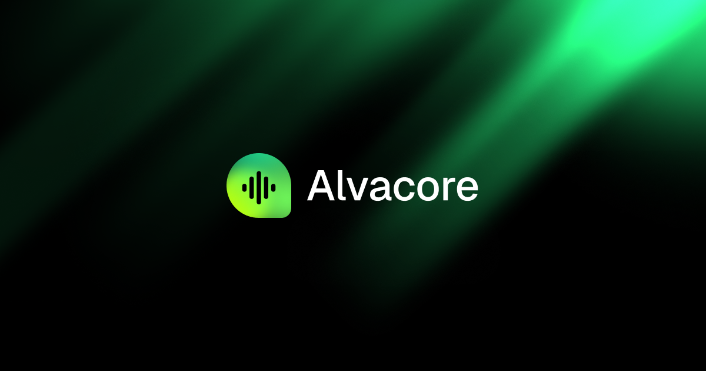

<p align="center">
  
</p>

<h1 align="center">Alvastudio</h1>

<p align="center">Speech data collection, review and annotation for Nigerian English and Nigerian Pidgin.</p>

<p align="center">
  <a href="https://studio.alvacoreai.com"></a>
  <a href="docs/alva-design-system.md"></a>
  <a href="docs/api.md"></a>
</p>

<p align="center">
  <a href="https://github.com/ALVA-CORE/Alvastudio/issues"></a>
  <a href="https://github.com/ALVA-CORE/Alvastudio/pulls"></a>
  <a href="https://github.com/ALVA-CORE/Alvastudio/graphs/contributors"></a>
  <a href="https://github.com/ALVA-CORE/Alvastudio/commits/main"></a>
</p>

<p align="center">
  
</p>

Alvastudio is Alva Core's studio for building speech datasets. Contributors record prompts and stories. Interns run focus groups and grade audio. Annotators correct transcripts and mark speakers. Admins watch the corpus, assign work and pay people. This repository is the web app.

The live app is [studio.alvacoreai.com](https://studio.alvacoreai.com). It talks to [api.alvacoreai.com](https://api.alvacoreai.com).

## What you can do

- Sign in as a contributor, intern, annotator or admin. Each role lands on its own home.
- Record **prompt reads** and **stimuli narration** in Nigerian English or Nigerian Pidgin.
- Run **focus-group sessions**, log participants and watch the live mic before you capture.
- Review submitted audio against a five-question quality rubric.
- Annotate focus-group tapes: edit cues, assign speakers and trim timings on a multitrack timeline.
- Track your own throughput, quality mix and demographic reach on role-specific dashboards.
- Manage prompts, users, reviews, annotations, corpus coverage and payouts from the admin area.
- Keep a wallet of points, see the leaderboard and follow payout status.

The app is **dark mode only**. There is no theme toggle.

## Who it is for

| Role | What they do |
| --- | --- |
| **Contributor** | Reads prompts, tells stories, watches points and payouts. |
| **Intern** | Runs focus groups, logs participants, reviews audio quality. |
| **Annotator** | Corrects transcripts, labels speakers, trims cue boundaries. |
| **Admin** | Owns prompts, users, corpus, assignment, payments and settings. |

Onboarding captures accent-relevant metadata up front: age, gender, state, languages and consent. That metadata is what makes the corpus usable later.

## Run locally

Use **Node.js 20+** and **npm**. The committed lockfile is `package-lock.json`.

```bash
git clone https://github.com/ALVA-CORE/Alvastudio.git
cd Alvastudio
npm install
cp .env.example .env
npm run dev
```

Open [http://localhost:3000](http://localhost:3000). The Vite server proxies `/api/v1` to `http://localhost:8000` unless you set something else.

| Variable | What it does |
| --- | --- |
| `VITE_API_BASE_URL` | Point the app at another host. Include the `/api/v1` prefix. |
| `VITE_API_PROXY_TARGET` | Keep same-origin calls and change where the proxy forwards them. |

Leave both unset to talk to a backend on your machine. For the live API, use `https://api.alvacoreai.com/api/v1`. See [`.env.example`](.env.example) and the [API reference](docs/api.md).

```bash
npm run typecheck
npm run lint
npm run test
npm run build
```

## How the work flows

1. A contributor or intern records speech against a prompt, a stimulus or a focus-group topic.
2. An intern reviews the clip. Noise, clipping, match to the prompt and naturalness all get a score.
3. Accepted audio stays in the corpus. Rejected audio is sent back with reasons.
4. Annotators open focus-group sessions, fix the transcript and mark who is speaking.
5. Admins watch coverage by state, language and demographic, then assign leftover work.

Contributor payouts sit on a floor-plus-bonus model: pay for audio we keep, delete audio we do not pay for. The legal reasoning is in [docs/leaderboard-payout-proposal.md](docs/leaderboard-payout-proposal.md).

## Built with

<p align="center">
  <a href="https://react.dev"></a>
  <a href="https://www.typescriptlang.org"></a>
  <a href="https://vite.dev"></a>
  <a href="https://tailwindcss.com"></a>
</p>

<p align="center">
  <a href="https://www.npmjs.com"></a>
  <a href="https://www.radix-ui.com"></a>
  <a href="https://tanstack.com/query"></a>
  <a href="https://zustand-demo.pmnd.rs"></a>
</p>

<p align="center">
  <a href="https://icons.pvtnbr.com"></a>
  <a href="https://www.zod.dev"></a>
  <a href="https://vitest.dev"></a>
  <a href="https://wavesurfer.xyz"></a>
</p>

React 19, TypeScript, Vite and Tailwind CSS, with Radix / shadcn primitives, TanStack Query and Zustand. Forms use React Hook Form and Zod. Charts use visx and a custom dither kit. The annotation workspace keeps its own store so playback never walks the undo stack.

```text
src/
├── components/   Role UI, shared chrome, charts and shadcn primitives
├── pages/        Route-level screens
├── routes/       Guards and the route map
├── lib/          Auth, annotation store, API client, tokens
├── data/         Mock datasets still standing in for unwired screens
├── hooks/        Shared hooks
└── index.css     Design tokens
docs/             Product, API and design references
public/assets/    Favicon, OG image and logos
```

Path alias: `@/*` → `src/*`.

## Design

Dark-mode only. One typeface, **Schibsted Grotesk**. One accent, `#25F07D`. Buttons are pills, cards are 16px, and the accent is scarce: one filled control per screen.

Copy the [design system](docs/alva-design-system.md) into another repo if you are building a landing page. Tokens live in `src/index.css` and `tailwind.config.ts`.

| Asset | Path | Used for |
| --- | --- | --- |
| Favicon (SVG) | [`public/assets/logos/favicon.svg`](public/assets/logos/favicon.svg) | Tab icon, in-app logo |
| Favicon (ICO) | [`public/assets/favicon.ico`](public/assets/favicon.ico) | Fallback tab icon |
| Open Graph image | [`public/assets/og.png`](public/assets/og.png) | Link previews, 1200×630 |

The HTML head points at those files as `/assets/logos/favicon.svg`, `/assets/favicon.ico` and `/assets/og.png`. Social crawlers use the absolute URLs on `studio.alvacoreai.com`.

## Documentation

| Guide | What it covers |
| --- | --- |
| [Product](docs/prd.md) | Roles, capture modes, review rubric and data model. |
| [Design system](docs/alva-design-system.md) | Font, colour, radius, buttons, beams and landing-page rules. |
| [Design tokens](docs/design-tokens.md) | Raw palette and semantic mapping. |
| [API](docs/api.md) | Endpoints, auth and request shapes against `api.alvacoreai.com`. |
| [Integration status](docs/integration-status.md) | What is live, what is still mock. |
| [Annotation workspace](docs/annotation-workspace.md) | Transcript editor, timeline and store. |
| [Admin UI](docs/admin-ui-spec.md) | Admin surfaces and how they map to the API. |
| [Payout model](docs/leaderboard-payout-proposal.md) | Floor-plus-bonus pay and NDPA notes. |

## Privacy

Voice recordings and contributor metadata are personal data under the Nigeria Data Protection Act 2023. Consent, retention and payout rules are written so we only keep audio we pay for. Keep real member details and credentials out of issues and pull requests.

WhatsApp numbers, bank details and review notes do not belong in public board copy. Organisers handle disputed accounts.

## Scripts

| Command | Description |
| --- | --- |
| `npm run dev` | Dev server on port **3000** |
| `npm run dev:clean` | Clear the Vite cache, then start |
| `npm run typecheck` | TypeScript, no emit |
| `npm run lint` | ESLint |
| `npm run test` | Vitest, once |
| `npm run build` | Typecheck, then production build to `dist/` |
| `npm run preview` | Serve the production build on port **3000** |
